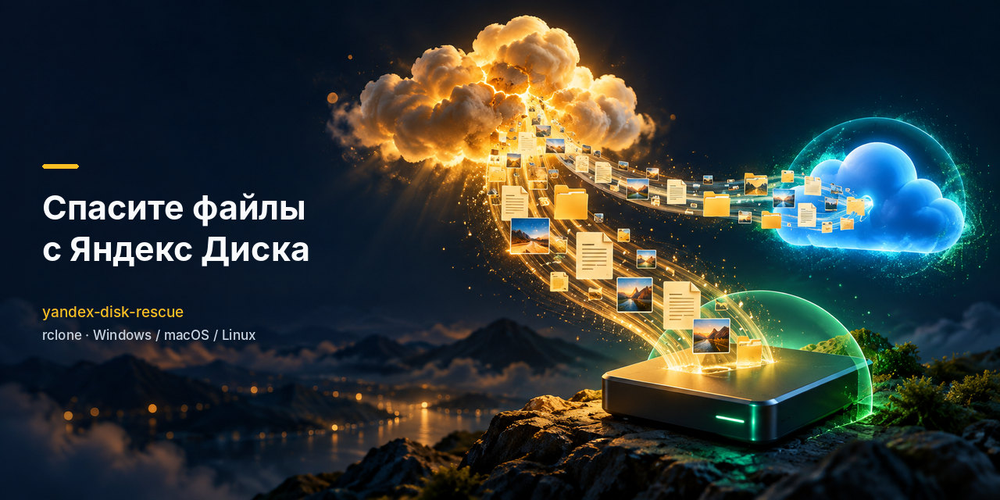

<div align="center">



# yandex-disk-rescue

**Спасите файлы с Яндекс Диска: весь Диск, включая «безлимитные» фото, на свой диск или в Google Drive.
Даже сейчас, когда Яндекс ограничил скачивание и часть файлов не отдаёт.**

[](LICENSE)
[](https://rclone.org)
[](https://github.com/KenGuru66/yandex-disk-rescue/commits/main)
[](https://github.com/KenGuru66/yandex-disk-rescue/stargazers)

[Быстрый старт](#быстрый-старт-windows) · [Выбрать способ](#выберите-способ) · [Фото из безлимита](docs/unlimited-photos.md) · [Ошибки](docs/troubleshooting.md) · [English](#english)

</div>

---

## Зачем это сейчас

8–11 октября 2026 года после атак беспилотников пострадали три дата-центра Яндекса: Сасово, Калуга
и Владимир ([Хабр](https://habr.com/ru/articles/1093198/), [Lenta.ru](https://lenta.ru/articles/2026/10/12/sboy-v-rabote-servisov-yandeksa/)).
Яндекс отключил в веб-версии Диска скачивание папок, альбомов и нескольких файлов сразу
([3DNews](https://3dnews.ru/1149774/yandeks-ogranichil-skachivaniya-s-diska-chtobi-snizit-nagruzku-na-utselevshie-datatsentri),
[vc.ru](https://vc.ru/services/3188990-yandeks-ogranichil-funktsii-diska)).
Если Диск — единственное место, где лежат ваши документы и фото, самое время сделать копию.

Обычные инструкции «поставьте rclone и скопируйте» сейчас не работают. Вот что мы выяснили на живом
аккаунте (1,8 ТБ, 13.10.2026) и чем этот проект отличается:

| Проблема | Что видно | Что здесь сделано |
|---|---|---|
| Приложению rclone Яндекс отвечает `410 GoneError` на любые файлы | `rclone config` проходит, а копирование нет | подключение по токену Полигона Яндекса ([как](docs/how-it-works.md#почему-токен-полигона)) |
| Фото из «безлимитной» автозагрузки не видны ни API, ни WebDAV | rclone их просто не находит | перенос в обычную папку, вручную или скриптом ([инструкция](docs/unlimited-photos.md)) |
| Около половины файлов сейчас не отдаются вообще | копирование «висит», потоки ждут | быстрый отказ, список неудачных файлов, повтор позже |
| Ссылки на скачивание выдаются от 1 до 60 секунд | скорость скачет | подобранные тайм-ауты и число потоков |
| Нужна уверенность, что копия целая | — | сверка по MD5 (`rclone check`) |

> [!IMPORTANT]
> Не используйте `rclone sync`: он **удаляет** в месте назначения то, чего нет на Диске. Здесь везде `copy`.

## Выберите способ

| Куда сохранить | Где запускать | Сложность | Инструкция |
|---|---|---|---|
| Внешний или второй диск | Windows | ★☆☆ | [docs/windows.md](docs/windows.md) |
| Внешний диск | macOS, Linux | ★☆☆ | [docs/linux-macos.md](docs/linux-macos.md) |
| Google Drive (или другое облако) | свой компьютер | ★★☆ | [docs/google-drive.md](docs/google-drive.md) |
| Облако, по расписанию, без своего ПК | VPS + Docker | ★★★ | [docs/vps.md](docs/vps.md) |
| Фото из «безлимита» | Chrome + Node.js или вручную | ★★☆ | [docs/unlimited-photos.md](docs/unlimited-photos.md) |

## Быстрый старт (Windows)

Нужны Windows 10/11, место на диске не меньше объёма Диска и 10 минут.

**1. Установите rclone** (в PowerShell), затем закройте и снова откройте PowerShell:
```powershell
winget install Rclone.Rclone
```

**2. Получите токен.** Откройте [Полигон Яндекс Диска](https://yandex.ru/dev/disk/poligon/), войдите в свой
аккаунт, нажмите **«Получить OAuth-токен»** и скопируйте его. Токен даёт полный доступ к Диску: никому
его не показывайте, после выгрузки отзовите ([как](docs/troubleshooting.md#как-отозвать-токен)).

**3. Подключите Диск** ([скрипт](scripts/add-yandex-remote.ps1) спросит токен и проверит доступ):
```powershell
irm https://raw.githubusercontent.com/KenGuru66/yandex-disk-rescue/main/scripts/add-yandex-remote.ps1 -OutFile add-yandex-remote.ps1
powershell -ExecutionPolicy Bypass -File .\add-yandex-remote.ps1
```

**4. Копируйте** (вместо `E:\YandexDisk` — ваша папка на внешнем диске):
```powershell
irm https://raw.githubusercontent.com/KenGuru66/yandex-disk-rescue/main/scripts/backup.ps1 -OutFile backup.ps1
powershell -ExecutionPolicy Bypass -File .\backup.ps1 -Dest E:\YandexDisk
```

**5. Повторяйте** ту же команду раз в день. Она докачает только то, чего ещё нет, в том числе файлы,
которые Яндекс сегодня не отдал, но вернёт позже. Список несохранённого — в `yandex-rescue-*-failed.txt`.

Без скриптов то же самое делается одной командой: см. [docs/windows.md](docs/windows.md#вручную-без-скриптов).

## Частые вопросы

<details>
<summary><b>Половина файлов с ошибкой — это нормально?</b></summary>

Сейчас да. Ошибки `timeout awaiting response headers` и `500 Internal Server Error` значат, что файл лежит
на недоступном сейчас сервере Яндекса. На тестовом аккаунте так было примерно с половиной файлов, и набор
не менялся между попытками. Сохраните то, что доступно, и запускайте копирование повторно: как только
Яндекс восстановит хранилище, файлы докачаются. Подробнее: [troubleshooting](docs/troubleshooting.md).
</details>

<details>
<summary><b>Почему не десктоп-клиент Яндекс Диска?</b></summary>

С 3 июня 2026 года клиент для Windows и macOS синхронизирует файлы **только при подписке Яндекс 360**,
без неё в нём открываются лишь файлы, уже сохранённые на компьютере
([3DNews](https://3dnews.ru/1142064/nastolnie-prilogeniya-yandeks-diska-perestanut-normalno-rabotat-u-besplatnih-polzovateley),
[Anti-Malware](https://www.anti-malware.ru/news/2026-06-03-111332/50254)). Если подписка есть, клиент
годится для простой копии на этом же компьютере, но это другой инструмент:

| | Десктоп-клиент | yandex-disk-rescue |
|---|---|---|
| Как копирует | двусторонняя синхронизация: удалилось на Диске — удалится и у вас | только `copy`, в копии ничего не удаляется |
| Куда | папка на этом компьютере | любой диск, Google Drive, другое облако, сервер |
| Место на ПК | под весь Диск; «файлы по запросу» по умолчанию остаются в облаке | для облака не нужно |
| Что не скачалось | не видно | список неудачных файлов, повтор |
| Проверка копии | нет | `rclone check` по MD5 |
| Фото из «безлимита» | есть опция «Копировать фото и видео на компьютер» | сначала [перенести в папку](docs/unlimited-photos.md) |

Если пользуетесь клиентом: включите офлайн-синхронизацию всех папок, а после выгрузки скопируйте папку
в другое место или остановите синхронизацию. Иначе любое удаление на Диске доедет и до копии.
</details>

<details>
<summary><b>Где мои фото из «безлимита»?</b></summary>

Их не видно ни через API, ни через WebDAV, поэтому rclone их не скопирует. Перенесите их в обычную папку Диска
(они начнут занимать место) или скачайте десктоп-приложением Яндекса (нужна подписка Яндекс 360). Три способа: [docs/unlimited-photos.md](docs/unlimited-photos.md).
</details>

<details>
<summary><b>Это безопасно? Куда уходят мои данные?</b></summary>

Скрипты только вызывают rclone на вашем компьютере: файлы идут напрямую из Яндекса туда, куда вы указали.
Токен хранится в конфиге rclone у вас на компьютере. После выгрузки отзовите его. Перед запуском скрипты
можно прочитать: они короткие.
</details>

<details>
<summary><b>Сколько это займёт?</b></summary>

Зависит от вашего канала и от Яндекса. Один поток через REST API даёт около 0,8 МБ/с; с 16 потоками на домашнем
канале это обычно 5–15 МБ/с, то есть 1 ТБ за 1–2 суток. На сервере с 64 потоками мы видели до 33 МБ/с.
</details>

<details>
<summary><b>Как проверить, что копия целая?</b></summary>

`rclone check yandex: E:\YandexDisk --one-way` сравнит файлы по MD5 и покажет, чего не хватает или что
отличается. Для Google Drive: `rclone check yandex: gdrive:Yandex-backup --one-way`.
</details>

## Как помочь

- ⭐ Поставьте звезду: так проект увидят те, кому он сейчас нужен.
- Поделитесь ссылкой с теми, у кого всё лежит на Яндекс Диске.
- Нашли ошибку или способ лучше? [Issue](https://github.com/KenGuru66/yandex-disk-rescue/issues/new/choose) или pull request ([CONTRIBUTING](CONTRIBUTING.md)).
  **Не вставляйте в issue токены и конфиг rclone.**

## Дисклеймер

Проект не связан с Яндексом. Он использует официальный REST API Диска, а для «безлимитных» фото —
внутренний API веб-версии, который может измениться в любой момент. Используйте на свой риск и всегда
выбирайте `copy`, а не `sync`.

Лицензия [MIT](LICENSE).

---

## English

**yandex-disk-rescue** helps you get all your files out of Yandex Disk, including photos stored in the
“unlimited” photo storage, onto a local drive or Google Drive, with rclone. As of October 2026, after
attacks on Yandex data centers, rclone's own OAuth app gets `410 GoneError`, unlimited photos are invisible
to both the REST API and WebDAV, and roughly half of the files on the tested account were not downloadable
at all. This repo provides a working connection method (Yandex Polygon OAuth token), copy scripts tuned
for fail-fast retries, a tool that moves unlimited photos into a regular folder through the web client's
internal API, MD5 verification, and a Docker setup for a VPS. Docs are in Russian; commands are
self-explanatory. Start with the [Windows quick start](#быстрый-старт-windows).
